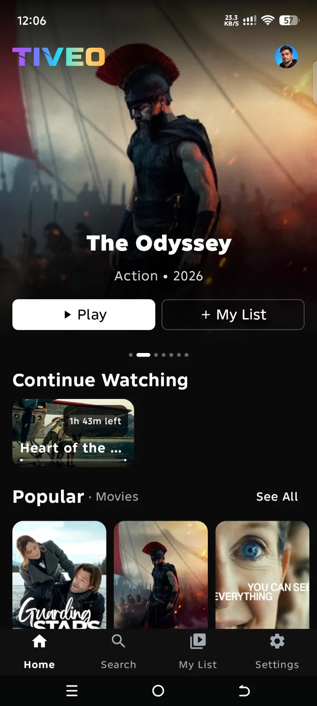
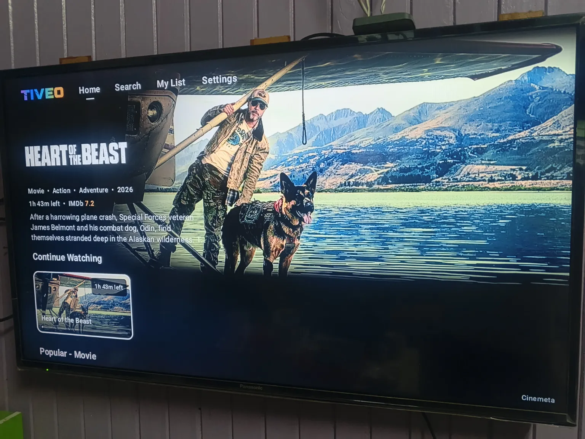

<p align="center">
  
</p>

<h1 align="center">Tiveo</h1>

<p align="center">Browse and stream from your configured sources on Android phones and Android TV, with a remote-friendly interface on the big screen.</p>

<p align="center">
  <a href="#download">Download</a> · <a href="#quick-start">Quick start</a> · <a href="#build-from-source">Build from source</a> · <a href="#support">Support</a>
</p>

## Screenshots

| Android mobile | Android TV |
| --- | --- |
|  |  |

## Features

- **Home and library** — Pick up episodes in Continue Watching, keep a watchlist and browse playback history.
- **Search** — Find a title by name or narrow the search by adding its release year.
- **Source selection** — Browse streams from configured sources, filter by provider and choose a stream before playback.
- **Playback controls** — Choose audio and subtitle tracks when available. Android TV supports navigation with a D-pad remote.
- **Content Manager** — Manage compatible add-ons and provider repositories.

## Download

Choose the APK for your device from the [Tiveo development release](https://github.com/nudroid12/Tiveo/releases/tag/tiveo-dev).

| Device | APK | Application ID |
| --- | --- | --- |
| Android phone or tablet | [Download Mobile APK](https://github.com/nudroid12/Tiveo/releases/download/tiveo-dev/Tiveo-MOB-dev.apk) | `com.tiveo.mobile` |
| Android TV or Android TV box | [Download TV APK](https://github.com/nudroid12/Tiveo/releases/download/tiveo-dev/Tiveo-TV-dev.apk) | `com.tiveo.tv` |

Both modules declare Android 6.0 (API 23) as their minimum SDK. These APKs are development builds.

## Quick start

1. Download and open the APK for your device. On TV, transfer the APK to the device and open it with a file manager.
2. If Android prompts you, allow APK installs for the app you used to open the file, then finish installation.
3. Open Tiveo. To add your own sources, go to **Settings → Content Manager** and add a compatible add-on or provider repository.
4. Open a title from Home or Search, choose an episode if applicable, then pick a source. Playback availability and tracks depend on the source you selected.

## Build from source

Use **JDK 17** and install **Android SDK Platform 36**. Set up the SDK in Android Studio or point Gradle to a local SDK installation.

```bash
git clone https://github.com/nudroid12/Tiveo.git
cd Tiveo
./gradlew :mobile:assembleDebug :tv:assembleDebug
```

On Windows, use `gradlew.bat`. The APKs are written to `mobile/build/outputs/apk/debug/` and `tv/build/outputs/apk/debug/`.

| Path | Purpose |
| --- | --- |
| `mobile/` | Android mobile UI and player |
| `tv/` | Android TV UI and remote navigation |
| `shared/core/` | Shared app logic |
| `shared/collections-ui/` | Shared collections components |

### Development releases

The **Tiveo Smart Build and Publish** workflow publishes signed APKs to `tiveo-dev`. It can be started manually from **Actions**, and also listens for successful **Apply ZIP Patch** runs. Release signing uses the `VIRIO_KEYSTORE_BASE64` and `VIRIO_KEYSTORE_PASSWORD` Actions secrets and the keystore alias `virio`.

## Support

Report reproducible app issues in [GitHub Issues](https://github.com/nudroid12/Tiveo/issues). Include the build, device model, Android version and steps to reproduce. Remove any private URLs or account details from logs before sharing them.

See [Third-party collections](THIRD_PARTY_COLLECTIONS.md) and [license notices](LICENSES/) for upstream credits and terms.

Developed by **NudroidLabs**.
